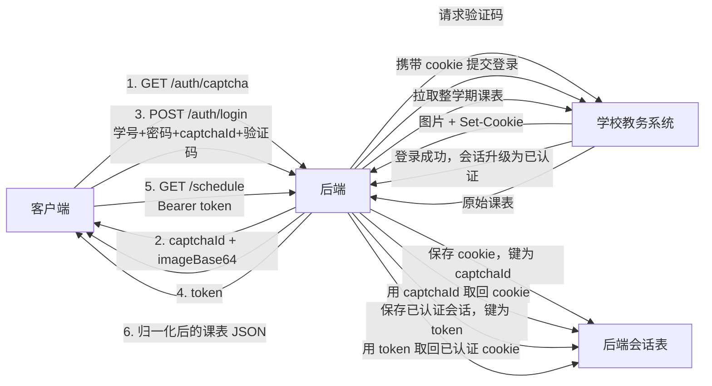
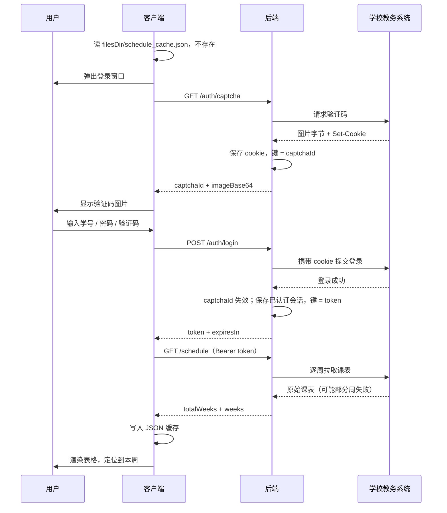
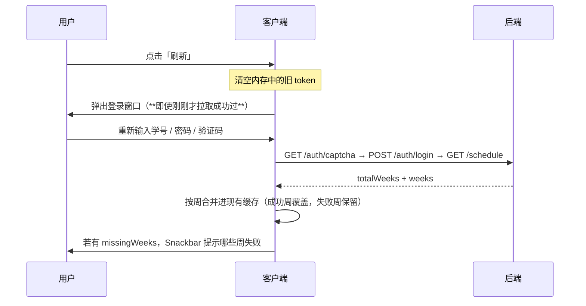

# Core++ 后端 API 文档

本文档定义 **Core++ 课表客户端**与其**自建后端**之间的 HTTP 契约。后端的主要职责是把学校教务系统的接口收敛成下面这三个稳定端点，并代为持有学校会话。

客户端已按本文档实现完毕，**后端照此对接即可，不需要改动客户端代码**。若确有无法实现之处，请同步修改本文档与客户端 DTO（`app/src/main/java/com/github/riley/coreplus/data/remote/dto/`）。

---

## 1. 基础信息

| 项 | 值 |
|---|---|
| Base URL（开发期） | `http://192.168.110.72:4326/api` |
| 版本前缀 | 无（不使用 `/v1`） |
| 字符编码 | UTF-8 |
| 请求 / 响应 Content-Type | `application/json; charset=utf-8`（验证码图片以 Base64 内联在 JSON 中，**不使用** `multipart` 或 `image/*` 响应） |
| 认证方式 | `Authorization: Bearer <token>`，token 由 `POST /auth/login` 下发 |
| 客户端 HTTP 库 | Ktor Client 3.6.0（OkHttp 引擎） |
| 客户端超时 | 连接 15 s，单次请求 120 s |
| JSON 反序列化 | `kotlinx.serialization`，`ignoreUnknownKeys = true` |

> [!IMPORTANT]
> **客户端开启了 `ignoreUnknownKeys`**，因此后端可以自由地在响应中增加字段，不会导致客户端解析失败。反过来，**删改字段名或类型属于破坏性变更**，需同步更新本文档。

### 1.1 为什么单次请求超时是 120 秒

`GET /schedule` 会触发后端向学校**逐周**拉取整学期数据。学校 API 慢且有配额，一次完整拉取可能耗时数十秒。请后端不要为此做「快速失败」，客户端已按长耗时设计（界面显示进度提示而非阻塞）。

---

## 2. 会话模型

学校教务系统是**两段式**的：先获取验证码图片（此时学校种下会话 cookie），再把验证码与账号密码一起提交。因此后端必须在两次客户端请求之间保存学校会话，这就是 token 存在的原因。



三级句柄的生命周期：

| 句柄 | 由谁持有 | 有效期 | 何时失效 |
|---|---|---|---|
| 学校 cookie（未认证） | 后端，键为 `captchaId` | `min(学校验证码有效期, 300 s)` | 被 `POST /auth/login` 消费后**立即**失效，无论登录成功与否 |
| 学校 cookie（已认证） | 后端，键为 `token` | 约 3600 s，且不超过学校会话本身的寿命 | TTL 到期、学校侧踢下线、`POST /auth/logout` |
| `token` | **客户端仅存内存** | 同上 | 进程被杀即消失；每次刷新都会重新登录 |

> [!CAUTION]
> **不要把学校的 cookie 透传给客户端。** 客户端只应持有 `captchaId` 与 `token` 这两个不透明字符串。
>
> **后端必须回收过期未使用的 `captchaId` 及其关联的学校会话**，否则用户反复打开登录框会造成内存泄漏。

---

## 3. 通用约定

### 3.1 错误响应

所有非 2xx 响应**必须**是如下 JSON 结构（即「错误信封」）：

```json
{
  "code": "CAPTCHA_INVALID",
  "message": "验证码错误或已过期"
}
```

| 字段 | 类型 | 必填 | 说明 |
|---|---|---|---|
| `code` | string | 是 | 机器可读错误码，取值**仅限**下表。客户端按 `code` 决定后续动作 |
| `message` | string | 是 | 面向用户的中文短句。网络类错误下客户端会**直接把它展示给用户**，请写得可读 |

> [!WARNING]
> **不要引入表外的新 `code`**。客户端遇到未知 `code` 会归为 `INTERNAL_ERROR`，只展示 `message`，无法做出正确的恢复动作（例如自动换验证码）。需要新增错误码时，请先更新本文档与客户端的 `AppError`。
>
> 网关／反向代理产生的**非 JSON** 错误页（如 nginx 的 HTML 502）客户端会归类为通用网络错误。请尽量保证错误响应也是 JSON。

### 3.2 错误码表

| `code` | HTTP | 触发场景 | **客户端动作** |
|---|---|---|---|
| `INVALID_REQUEST` | 400 | 请求体缺字段、类型错误、JSON 格式非法 | 展示 `message` |
| `CAPTCHA_INVALID` | 401 | 学校判定验证码错误 | **自动重新拉取验证码**、清空验证码输入框、展示 `message` |
| `CAPTCHA_EXPIRED` | 401 | `captchaId` 不存在或已过期 | 同上 |
| `CREDENTIALS_INVALID` | 401 | 学号或密码错误 | **自动重新拉取验证码**、清空验证码输入框、展示 `message` |
| `TOKEN_EXPIRED` | 401 | token TTL 到期 | 结束当前流程，要求重新登录 |
| `TOKEN_INVALID` | 401 | token 格式非法或后端查无此 token | 同上 |
| `UPSTREAM_SESSION_LOST` | 401 | token 未过期，但其背后的**学校会话**已失效（学校侧超时、账号在别处登录被踢、出口 IP 变化） | 同上 |
| `RATE_LIMITED` | 429 | 触发限流 | 展示 `message`，读取 `Retry-After` 响应头（秒）提示等待时间，**不自动重试** |
| `UPSTREAM_UNAVAILABLE` | 502 / 504 | 学校教务系统不可达或超时 | 展示 `message`，提示稍后再试 |
| `INTERNAL_ERROR` | 500 | 后端自身异常，以及一切未知 `code` | 展示 `message` |

HTTP 状态码与 `code` 的对应关系需保持一致：客户端优先读 `code`，仅在响应体无法解析时才退化为按状态码归类。

---

## 4. 端点

### 4.1 获取验证码

```
GET /api/auth/captcha
```

无需认证。

#### 响应 200

```json
{
  "captchaId": "c9f1a2b3-4d5e-6f70-8192-a3b4c5d6e7f8",
  "imageBase64": "/9j/4AAQSkZJRgABAQAAAQABAAD...",
  "imageMediaType": "image/jpeg",
  "expiresIn": 300
}
```

| 字段 | 类型 | 必填 | 说明 |
|---|---|---|---|
| `captchaId` | string | 是 | 后端为「本次学校会话」生成的句柄（建议 UUID）。客户端登录时**原样回传**。**一次性** |
| `imageBase64` | string | 是 | 学校返回的验证码图片**原始字节**的 Base64。标准字母表、不换行、**不要**加 `data:image/...;base64,` 前缀 |
| `imageMediaType` | string | 否 | 图片 MIME 类型，**仅用于排查**。客户端用 `BitmapFactory.decodeByteArray` 解码，PNG/JPEG/GIF/WebP 均可，不依赖此字段 |
| `expiresIn` | int | 否 | 该 `captchaId` 的剩余有效秒数，建议 300 |

#### 后端行为

1. 向学校验证码接口发起请求，**保存学校返回的全部 cookie**（`JSESSIONID` 等）
2. 生成 `captchaId`，在服务端建立 `captchaId → 学校 cookie` 映射，TTL = `min(学校验证码有效期, 300 s)`
3. 把图片**原始字节**做 Base64 后返回

#### 契约要求

- **不校验答案**：本接口不验证任何用户输入，验证码正确性由学校在登录时判定
- **原样透传图片**：不要重新绘制、缩放或转码，学校验证码可能带有干扰线与扭曲，二次处理会降低识别率
- **一次性消费**：`captchaId` 被 `POST /auth/login` 使用一次后即失效（学校侧验证码校验一次就作废）。因此客户端**每次登录尝试前都会重新调用本接口**，包括失败重试
- **可能的错误**：`UPSTREAM_UNAVAILABLE`（学校验证码接口不可达）、`RATE_LIMITED`

---

### 4.2 登录

```
POST /api/auth/login
Content-Type: application/json
```

无需认证。

#### 请求体

```json
{
  "studentId": "2023010101",
  "password": "p@ssw0rd",
  "captchaId": "c9f1a2b3-4d5e-6f70-8192-a3b4c5d6e7f8",
  "captchaCode": "a3kd"
}
```

| 字段 | 类型 | 必填 | 约束 |
|---|---|---|---|
| `studentId` | string | 是 | 学号，非空，建议 ≤ 32 字符 |
| `password` | string | 是 | **明文密码**，非空。参见 [§6 安全注意事项](#6-安全注意事项) |
| `captchaId` | string | 是 | `GET /auth/captcha` 的返回值，原样回传 |
| `captchaCode` | string | 是 | 用户输入的验证码文本。**不要自行做大小写归一化或去空格**——是否区分大小写由学校决定，原样转发 |

#### 响应 200

```json
{
  "token": "eyJhbGciOiJIUzI1NiIsInR5cCI6IkpXVCJ9...",
  "tokenType": "Bearer",
  "expiresIn": 3600,
  "studentId": "2023010101",
  "name": "张三"
}
```

| 字段 | 类型 | 必填 | 说明 |
|---|---|---|---|
| `token` | string | 是 | 后续请求的 `Authorization: Bearer <token>`。本质是**后端所持已认证学校会话的句柄**，对客户端不透明 |
| `tokenType` | string | 是 | 固定 `"Bearer"` |
| `expiresIn` | int | 是 | 有效期（秒），约 3600 |
| `studentId` | string | 是 | 回显，供客户端核对 |
| `name` | string | 否 | 学生姓名。学校若返回则透传，客户端可用于界面展示；无则省略该字段（**不要**填 `null` 以外的占位值，缺字段与 `null` 客户端都能处理） |

#### 后端行为

1. 用 `captchaId` 取回学校 cookie；取不到或已过期 → `CAPTCHA_EXPIRED`
2. 携带该 cookie 向学校提交登录（学号 + 密码 + 验证码）。学校要求的其他隐藏表单域、`Referer`、`User-Agent` 等**由后端补齐**，客户端不感知
3. 学校判定验证码错误 → `CAPTCHA_INVALID`；学号或密码错误 → `CREDENTIALS_INVALID`
4. 成功 → 生成 token，建立 `token → 已认证学校会话` 映射，TTL ≈ 3600 s
5. **无论成功还是失败，`captchaId` 及其关联的学校会话都必须立即失效**

#### 可能的错误

`INVALID_REQUEST`、`CAPTCHA_EXPIRED`、`CAPTCHA_INVALID`、`CREDENTIALS_INVALID`、`UPSTREAM_UNAVAILABLE`、`RATE_LIMITED`、`INTERNAL_ERROR`

---

### 4.3 获取整学期课表

```
GET /api/schedule
Authorization: Bearer <token>
```

#### 查询参数（预留，当前客户端不使用）

| 参数 | 类型 | 说明 |
|---|---|---|
| `weeks` | string | 逗号分隔的周次列表，如 `weeks=3,7`，表示只重拉这几周。客户端目前总是全量拉取；若后端实现了增量，将来可用于「只重试失败的周」 |

#### 响应 200

```json
{
  "totalWeeks": 20,
  "weeks": [
    {
      "weekNumber": 1,
      "courses": [
        {
          "id": "2026-2027-1-01234-01",
          "name": "计算机组成原理",
          "credit": 3.0,
          "attribute": "必修",
          "location": "致远楼605",
          "teacher": "李四",
          "weekday": 1,
          "bigSection": 1
        }
      ]
    }
  ]
}
```

##### 顶层字段

| 字段 | 类型 | 必填 | 说明 |
|---|---|---|---|
| `totalWeeks` | int | 是 | 学期总周数，≥ 1。客户端用它作为周次选择器上界，并据此判断「部分成功」 |
| `weeks` | array | 是 | **成功拉取到的周**，是 `1..totalWeeks` 的任意子集，**可以是空数组** |

##### `weeks[]`

| 字段 | 类型 | 必填 | 说明 |
|---|---|---|---|
| `weekNumber` | int | 是 | 取值 `1..totalWeeks`，同一响应内**不得重复** |
| `courses` | array | 是 | 该周全部课程条目。该周确实无课时返回 `[]` |

##### `courses[]`

| 字段 | 类型 | 必填 | 说明 |
|---|---|---|---|
| `id` | string | 否 | 学期内唯一且稳定的标识，用于客户端删除课程与列表 key。**强烈建议下发**（例如学校课程编号 + 序号）。缺失时客户端会合成 `w{week}-d{weekday}-s{bigSection}-{name.hashCode()}`，合成值在课程改名后会变化 |
| `name` | string | 是 | 课程名称。**连课合并判据之一** |
| `credit` | number | 是 | 学分，浮点数，允许 `0.5` / `1.5`。学校未提供时填 `0` |
| `attribute` | string | 是 | 课程属性，如 `"必修"`、`"选修"`、`"限选"`、`"任选"`。学校原样透传即可，客户端不做枚举校验，未知值按原字符串显示。无值时填空串 |
| `location` | string | 是 | 上课地点，如 `"致远楼605"`。无固定教室时填空串。**连课合并判据之一** |
| `teacher` | string | 是 | 任课教师。多位教师用 `"、"` 或 `","` 分隔均可，但**同一门课在所有周内必须完全一致**（连课合并判据）。未知时填空串 |
| `weekday` | int | 是 | 星期，ISO-8601：`1`=星期一 … `7`=星期日 |
| `bigSection` | int | 是 | 大节序号，从 `1` 开始。上限由客户端作息表决定，当前内置默认 **5** 个大节；超出范围的大节会被客户端忽略 |

> [!NOTE]
> **课程条目内没有 `week` 字段**。所属周由外层 `weeks[].weekNumber` 决定，客户端在映射到领域模型时自动填充。这是相对设计文档 §2.1 的有意调整，避免同一条信息重复两次。

#### 关键规则

##### 规则 1：四小节连课必须拆成两条记录

例如某课周一第 1、2 大节连上（即 4 小节），必须下发两条记录：

```json
{ "id": "...-01", "name": "数据结构", "location": "致远楼402", "teacher": "孙七", "weekday": 2, "bigSection": 3 }
{ "id": "...-02", "name": "数据结构", "location": "致远楼402", "teacher": "孙七", "weekday": 2, "bigSection": 4 }
```

三条判据字段（`name` / `location` / `teacher`）**必须完全相同**，客户端才能在 UI 层把它们合并成一个跨两行的块。

之所以不在后端合并：数据层必须保持「一条记录 = 一个大节」，因为用户可能只想删除其中一节；合并纯粹是视觉行为（设计文档 §2.4）。

##### 规则 2：同一格子只应有一条记录

同一 `(weekNumber, weekday, bigSection)` 只应出现一条记录。若学校数据确实存在冲突（极罕见），后端应择一保留；客户端只会显示遇到的第一条。

##### 规则 3：部分成功语义（**最重要**）

学校 API 有严格的请求数量与时间限制，后端按周拉取时可能有若干周失败。此时：

- 失败的周**直接从 `weeks` 数组中省略**
- **不要**用「`courses: []` 的空周对象」占位——那会被客户端理解为「这周确实没课」，从而错误地覆盖掉本地已有的缓存

客户端收到响应后的合并行为：

| 情况 | 客户端行为 |
|---|---|
| 周出现在 `weeks` 中 | **覆盖**本地缓存中该周的数据 |
| 周未出现在 `weeks` 中 | **保留**本地已有缓存 |
| `missingWeeks = (1..totalWeeks) − weeks[].weekNumber` 非空 | 提示「第 X、Y 周拉取失败，已保留本地数据」 |
| 某周既没拉到、本地也没有 | 表格显示空白；若用户切换到该周，显示**上一周**的课程并提示这是回退显示 |

因此 `weeks` 允许只包含 1 周，也允许为空数组（`200` + `"weeks": []` 表示「一次都没拉到」，客户端会完整保留旧缓存并提示全部失败）。

##### 规则 4：不需要全量

后端不必保证每次返回全部周。客户端按周合并，多次部分成功的结果会逐步累积成完整缓存。

#### 可能的错误

`TOKEN_EXPIRED`、`TOKEN_INVALID`、`UPSTREAM_SESSION_LOST`、`UPSTREAM_UNAVAILABLE`、`RATE_LIMITED`、`INTERNAL_ERROR`

> [!IMPORTANT]
> **`UPSTREAM_SESSION_LOST` 与 `TOKEN_EXPIRED` 请分别返回**，不要混用。前者意味着「我们的 token 还有效，但学校那边已经掉线」，后者意味着「token 本身到期」。客户端目前对两者的动作相同（要求重新登录），但区分它们能让日志与将来的用户提示更准确。

---

### 4.4 登出（预留）

```
POST /api/auth/logout
Authorization: Bearer <token>
```

响应 `204 No Content`，无响应体。后端销毁 token 及其关联的学校会话。

**客户端当前不调用此端点**——token 只存内存，进程结束自然消失，且每次刷新都重新登录。保留此端点是为了将来增加「退出登录」按钮时不必改动契约。

---

## 5. 典型链路

### 5.1 冷启动（本地无缓存）



### 5.2 冷启动（本地有缓存）

不发起任何网络请求。直接读缓存 → 渲染 → 定位到本周。这是设计文档「缓存不过期，一学期只请求一次」的体现。

### 5.3 刷新



**每次刷新都必须重新登录**，客户端不提供「复用旧 token 直接刷新」的入口。这是设计文档的明确要求（token 不缓存）。

---

## 6. 安全注意事项

> [!CAUTION]
> **开发期走 HTTP，学号与密码以明文经局域网传输。** 上线**必须**切换到 HTTPS。届时客户端会移除 debug 源集中的明文放行配置（`app/src/debug/res/xml/network_security_config.xml`），release 构建默认已禁止明文流量。

| 项 | 要求 |
|---|---|
| 传输加密 | 生产环境强制 HTTPS。开发期 HTTP 仅限可信局域网 |
| 日志脱敏 | `POST /auth/login` 的请求体含**明文密码**。访问日志必须过滤 body，或只记录 `studentId` 与结果码。切勿把请求体写进错误上报 |
| 凭据存储 | 客户端不持久化学号、密码、token；token 只存内存单例。后端也**不应**存储用户密码（学校会话 cookie 用完即弃） |
| 学校 cookie | 不得透传给客户端，不得写入日志 |
| 验证码 | 一次性，校验后立即失效；后端需回收过期未用的验证码会话 |
| 限流 | 学校 API 有严格配额。建议：`/auth/captcha` 与 `/auth/login` 按 **IP + 学号**限流（如 10 次/分钟）；`/schedule` 限制并发（如全局 2 路）。命中时返回 `429` + `Retry-After` 响应头（秒），客户端会展示等待提示而**不会**自动重试，避免形成重试风暴 |
| 输入校验 | `studentId` / `password` / `captchaCode` 均应做长度与非空校验，非法时返回 `400 INVALID_REQUEST`，不要转发给学校 |

---

## 7. 附录 A：可直接使用的 mock 响应

以下 JSON 可作为 `GET /api/schedule` 的 mock 响应，用于在后端未完成时联调客户端。它与客户端 debug 构建中「载入示例课表」写入的数据完全一致。

`totalWeeks` 为 2，`weeks` 完整包含两周，属于**全量成功**场景。第 1 周含一组四小节连课（周二第 3、4 大节的「数据结构」）与一组两节连课（周一第 1、2 大节的「计算机组成原理」），用于验证视觉合并。

```json
{
  "totalWeeks": 2,
  "weeks": [
    {
      "weekNumber": 1,
      "courses": [
        { "id": "mock-1001", "name": "计算机组成原理", "credit": 3.0, "attribute": "必修", "location": "致远楼605", "teacher": "李四", "weekday": 1, "bigSection": 1 },
        { "id": "mock-1002", "name": "计算机组成原理", "credit": 3.0, "attribute": "必修", "location": "致远楼605", "teacher": "李四", "weekday": 1, "bigSection": 2 },
        { "id": "mock-1003", "name": "大学体育", "credit": 1.0, "attribute": "必修", "location": "体育馆", "teacher": "王五", "weekday": 1, "bigSection": 4 },
        { "id": "mock-1004", "name": "高等数学（上）", "credit": 5.0, "attribute": "必修", "location": "主楼301", "teacher": "赵六", "weekday": 2, "bigSection": 1 },
        { "id": "mock-1005", "name": "数据结构", "credit": 4.0, "attribute": "必修", "location": "致远楼402", "teacher": "孙七", "weekday": 2, "bigSection": 3 },
        { "id": "mock-1006", "name": "数据结构", "credit": 4.0, "attribute": "必修", "location": "致远楼402", "teacher": "孙七", "weekday": 2, "bigSection": 4 },
        { "id": "mock-1007", "name": "线性代数", "credit": 3.0, "attribute": "必修", "location": "主楼205", "teacher": "周八", "weekday": 3, "bigSection": 2 },
        { "id": "mock-1008", "name": "大学英语（三）", "credit": 4.0, "attribute": "必修", "location": "外语楼110", "teacher": "吴九", "weekday": 4, "bigSection": 1 },
        { "id": "mock-1009", "name": "形势与政策", "credit": 0.5, "attribute": "必修", "location": "报告厅", "teacher": "郑十", "weekday": 4, "bigSection": 5 },
        { "id": "mock-1010", "name": "操作系统", "credit": 3.5, "attribute": "限选", "location": "致远楼603", "teacher": "李四", "weekday": 5, "bigSection": 3 }
      ]
    },
    {
      "weekNumber": 2,
      "courses": [
        { "id": "mock-2001", "name": "计算机组成原理", "credit": 3.0, "attribute": "必修", "location": "致远楼605", "teacher": "李四", "weekday": 1, "bigSection": 1 },
        { "id": "mock-2002", "name": "计算机组成原理", "credit": 3.0, "attribute": "必修", "location": "致远楼605", "teacher": "李四", "weekday": 1, "bigSection": 2 },
        { "id": "mock-2003", "name": "高等数学（上）", "credit": 5.0, "attribute": "必修", "location": "主楼301", "teacher": "赵六", "weekday": 2, "bigSection": 1 },
        { "id": "mock-2004", "name": "数据结构", "credit": 4.0, "attribute": "必修", "location": "致远楼402", "teacher": "孙七", "weekday": 2, "bigSection": 3 },
        { "id": "mock-2005", "name": "数据结构", "credit": 4.0, "attribute": "必修", "location": "致远楼402", "teacher": "孙七", "weekday": 2, "bigSection": 4 },
        { "id": "mock-2006", "name": "线性代数", "credit": 3.0, "attribute": "必修", "location": "主楼205", "teacher": "周八", "weekday": 3, "bigSection": 2 },
        { "id": "mock-2007", "name": "大学英语（三）", "credit": 4.0, "attribute": "必修", "location": "外语楼110", "teacher": "吴九", "weekday": 4, "bigSection": 1 },
        { "id": "mock-2008", "name": "计算机网络", "credit": 3.0, "attribute": "限选", "location": "致远楼601", "teacher": "钱十一", "weekday": 5, "bigSection": 3 }
      ]
    }
  ]
}
```

### 部分成功的响应示例

学期共 20 周，后端只成功拉到第 1、2、4 周，其余周向学校请求失败：

```json
{
  "totalWeeks": 20,
  "weeks": [
    { "weekNumber": 1, "courses": [ /* ... */ ] },
    { "weekNumber": 2, "courses": [ /* ... */ ] },
    { "weekNumber": 4, "courses": [ /* ... */ ] }
  ]
}
```

客户端据此算出 `missingWeeks = [3, 5, 6, …, 20]`，提示「18 周拉取失败，已保留本地数据」，并把第 1、2、4 周写入缓存，第 3 周等保持原样（若本地原本也没有，则显示空白）。

### 一次都没拉到的响应

```json
{ "totalWeeks": 20, "weeks": [] }
```

HTTP 状态仍是 `200`。客户端完整保留旧缓存，提示全部周次拉取失败。**不要**用 `500` 表达这种情况——那是后端自身异常，语义不同。

---

## 8. 附录 B：客户端侧的实现约定

后端对接时可能需要了解的客户端行为，均已实现：

| 行为 | 说明 |
|---|---|
| 缓存位置 | `filesDir/schedule_cache.json`，应用内部存储，不随系统备份导出敏感数据 |
| 缓存写入 | 原子写（临时文件 → `fsync` → `rename`），进程被杀不会产生半截文件 |
| 缓存过期 | **永不过期**。首次成功拉取后整个学期不再请求，除非用户主动刷新 |
| 缓存损坏 | 解析失败时备份为 `schedule_cache.json.corrupt` 并当作无缓存处理，不会崩溃 |
| 本地编辑 | 用户删除课程**直接覆盖缓存**，下次刷新会丢失。这是设计文档接受的取舍 |
| token 存储 | 仅内存单例，不落盘 |
| 凭据存储 | 不存储。登录对话框关闭即清空 |
| 未知字段 | `ignoreUnknownKeys = true`，后端可自由增加响应字段 |
| 学期开始日期 | **完全由客户端决定**，不需要后端提供。用户可从日历选择某个星期一，未选择时按「3 月 1 日 / 9 月 1 日所在周的星期一」自动推断 |
| 作息时间表 | 完全由客户端本地维护（夏/冬两套），不需要后端提供 |
